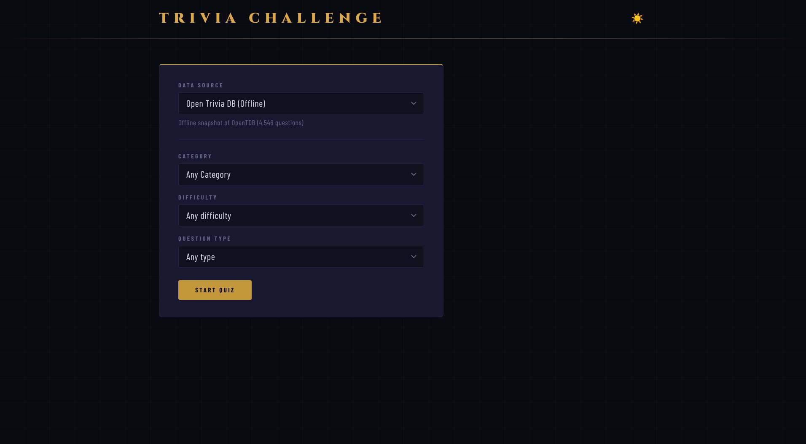
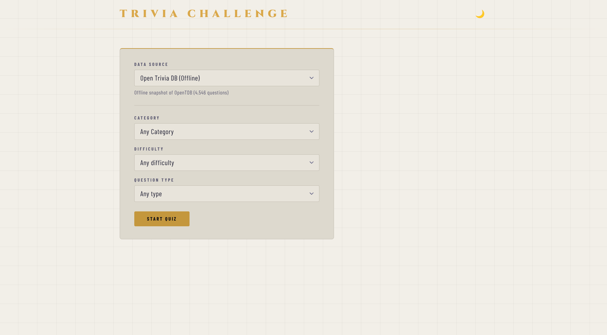

# Trivia App

**Live demo: https://trivia-app.labnerd.net/**

A trivia quiz app built with React and TypeScript, deployed as a static site on Cloudflare Workers. There is no backend: every request goes straight from the browser to the question source.

<p>
  
  
</p>

## Features

- Four question sources behind one interface: two live APIs ([Open Trivia Database](https://opentdb.com), [The Trivia API](https://the-trivia-api.com)) and offline snapshots of both
- Filter by category, difficulty, and question type; the form adapts to what each source supports
- Paginated sessions: fetch the next 10 questions without leaving the quiz
- Light and dark themes, persisted per browser
- Opens on an offline snapshot, so the app works even when the live APIs are down

## What this demonstrates

- **Provider abstraction.** Each source is a plain object implementing one `Provider` interface (`src/api/providers.ts`, `src/api/adapters/`). Responses are normalized to a single question shape, and the UI adapts to each provider's declared difficulties and types. Adding a source means implementing the interface and registering it.
- **State and data fetching.** Provider selection, session tokens, and category live in a context (`src/context/ProviderContext.tsx`). A `useFetch` hook owns loading, error, retry, and `AbortController` cleanup, with a cancelled-flag guard against state updates after unmount.
- **Input validation.** Route params for category, difficulty, and type are checked against the provider's allowlists before any request is made.
- **Offline data pipeline.** `scripts/download-trivia.mjs` builds the offline snapshots from the live APIs.
- **Card-scanning pipeline.** `scripts/scanner.py` extracts questions from photographed trivia cards using the Anthropic vision API, and `scripts/import-cards.js` merges and dedupes the output. See [docs/scanner/ARCHITECTURE.md](docs/scanner/ARCHITECTURE.md). The resulting datasets come from commercial card games, so they are kept local and are not part of this repository or the deployed site.
- **Testing and deployment.** Vitest and Testing Library cover providers, context, hooks, and pages. Cloudflare Workers Builds deploys on every push to `main`.

## Development

```bash
npm install
npm run dev        # dev server on port 3000
npm run build      # production build to dist/
npm run preview    # build + serve preview on port 3000
npm run lint       # ESLint
npm run typecheck  # TypeScript type check
npm run test       # Vitest
```

To enable the local-only card game providers, generate their data with the scanner pipeline and set `VITE_LOCAL_CARDS=true` in `.env.local`.

## Stack

- React 19, React Router 7
- TypeScript 5 (strict mode)
- Vite 7, Vitest, Testing Library
- Axios
- Cloudflare Workers (static assets with SPA fallback)

## Analytics

The deployed site loads a self-hosted [Umami](https://umami.is) script for anonymous page-view counts. It sets no cookies.
